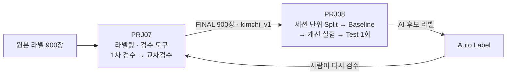
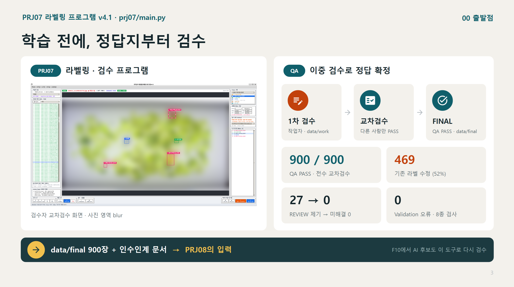
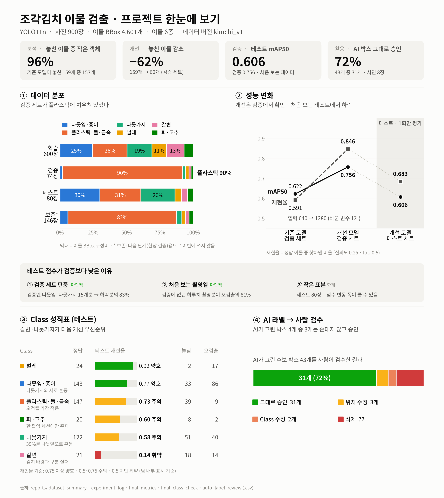

# Team01 Projects · 조각김치 이물 검출

식품 공장의 조각김치 이물 사진 900장으로 **라벨 검수 도구를 직접 만들고(PRJ07)**, 그 정답지로 **YOLO11n 검출 모델을 학습 · 평가한 뒤(PRJ08)**, 모델이 만든 라벨을 다시 PRJ07 도구로 사람이 검수하는 **한 사이클**을 완성했습니다.

> 📑 **최종 발표 자료**: [PDF](presentation/team01_prj07_prj08.pdf) · [Google Slides](https://docs.google.com/presentation/d/1lfYxkO_q-nYkV291dwh8UB7X9kVs7-QH/preview)
> ※ 회사 데이터(NDA) 보호를 위해 원본 사진 · 라벨 · 모델은 Git에 올리지 않았고, 모든 사진은 blur 처리했습니다.

## 한눈에 보기

| | [PRJ07 · 라벨링 도구](./prj07) | [PRJ08 · 이물 검출 모델](./prj08) |
|---|---|---|
| **한 일** | Python · tkinter로 라벨 검수 프로그램 v4.1 제작 · 5명 1차 검수 → 다른 사람 교차검수 | 촬영 세션 단위 Split · YOLO11n Baseline → 실패 분석 → 변수 1개 개선 → Frozen Test 1회 |
| **핵심 숫자** | QA PASS **900 / 900** · 기존 라벨 **52%(469장)** 수정 · REVIEW 27 → 미해결 0 · 본인 PASS 0건 | Val mAP50 **0.622 → 0.756** · 놓침 159 → 60 · Test mAP50 **0.606** (1회) · AI 후보 **72%** 그대로 승인 |
| **넘긴 것** | FINAL 900장 + 교과 8 Handoff 문서 | Final Model + 교과 14 Handoff · Acceptance **33 / 33** |
| **기록** | [README](./prj07) · [코드 리뷰](prj07/docs/code_review/README.md) · Release `v4.1` | [README](./prj08) · [코드 리뷰](prj08/docs/code_review/README.md) · Tag `subject8_final_v1` |

<table>
  <tr>
    <td width="50%"></td>
    <td width="50%"></td>
  </tr>
  <tr>
    <td align="center">PRJ07 · 900장 이중 검수</td>
    <td align="center">PRJ08 · 학습 · 평가 · 자동 라벨 결과</td>
  </tr>
</table>

## 팀

| 팀원 | PRJ07 역할 | PRJ08 역할 |
|:-:|---|---|
| 최용훈 [`@yonghoonchoi88`](https://github.com/yonghoonchoi88) | PM / Integrator | PM / Integrator |
| 박건 [`@howolcat`](https://github.com/howolcat) | Program / Validation | Evaluation / Failure · Experiment |
| 심준형 [`@simpson92`](https://github.com/simpson92) | QA / Test | Data / QA · Training |
| 김하민 [`@hxxdxm`](https://github.com/hxxdxm) | Docs / Guide | Inference / Document |
| 이승훈 [`@lee26060715`](https://github.com/lee26060715) | Feature / Record | — |

> 자세한 작업 내용은 각 프로젝트 README의 **팀** 표를 참고합니다.

## 기술 · 규칙

- **환경**: Python 3.10 · PyTorch 2.14.1 · Ultralytics 8.4.175 · RTX 3060 (5명 동일 버전)
- **협업**: 개인 branch → Pull Request → `main` merge · 팀장만 merge
- **보안**: 원본 데이터 · 학습 결과 · 가중치는 `.gitignore`로 제외 (NDA)
